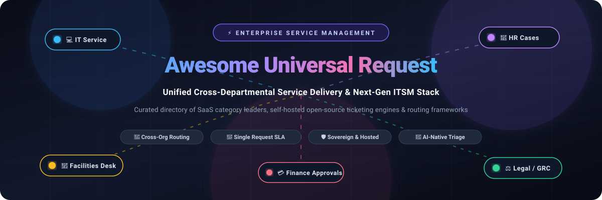

<p align="center">
  
</p>

<p align="center">
  <a href="https://github.com/ishandutta2007/Awesome-Awesome-Awesome"></a>
  <a href="https://discord.gg/jc4xtF58Ve"></a>
  <a href="https://github.com/ishandutta2007/Awesome-Universal-Request/stargazers"></a>
  <a href="https://github.com/ishandutta2007/Awesome-Universal-Request/network/members"></a>
  <a href="https://github.com/ishandutta2007/Awesome-Universal-Request/issues"></a>
  <a href="LICENSE"></a>
  <a href="https://github.com/ishandutta2007"></a>
</p>

---

# 🌐 Awesome Universal Request

> **A curated, battle-tested directory of leading SaaS platforms, sovereign open-source projects, and architectural frameworks for Universal Request, Enterprise Service Management (ESM), Cross-Departmental Workflows, and Unified Employee Portals.**

**Universal Request** revolutionizes organizational support by providing a single, unified entry point for all service inquiries. Instead of forcing employees or customers to navigate disjointed departmental silos—guessing whether an onboarding request belongs to IT, HR, Legal, Procurement, or Facilities—users submit a request once. The underlying platform transparently routes, transfers, orchestrates, and monitors SLAs across business units with full context retention and continuous visibility.

---

## 📑 Table of Contents

- [🎯 What is Universal Request?](#-what-is-universal-request)
- [📊 Sector Overview & Market Dynamics](#-sector-overview--market-dynamics)
- [🏢 SaaS & Hosted Enterprise Platforms](#-saas--hosted-enterprise-platforms)
- [🛠️ Open-Source GitHub Projects](#️-open-source-github-projects)
- [📐 Core Architecture & Implementation Patterns](#-core-architecture--implementation-patterns)
- [💡 Evaluation & Selection Checklist](#-evaluation--selection-checklist)
- [🤝 How to Contribute](#-how-to-contribute)
- [💖 Support & Community](#-support--community)
- [📈 Star History](#-star-history)
- [🛡️ Disclaimer](#️-disclaimer)

---

## 🎯 What is Universal Request?

In traditional enterprises, requesting services is fragmented:
- 💻 **IT Issues** go to Jira or ServiceNow.
- 👥 **HR Inquiries** go to Workday or an email alias.
- 🏢 **Facility Needs** live in a local facilities portal.
- ⚖️ **Legal & Contract Reviews** hide inside email chains or spreadsheets.

**Universal Request (UR)** dissolves these boundaries. It establishes an intelligent routing umbrella where:
1. **Single Point of Contact:** Employees use a unified self-service portal, virtual agent, or conversational interface (Slack / Microsoft Teams).
2. **Context-Preserving Transfers:** When a ticket moves between teams (e.g., an IT laptop refresh that requires HR clearance and Finance approval), all comments, attachments, and audit histories persist without forcing the requester to re-submit.
3. **Unified SLA Tracking:** Cross-functional SLAs govern the lifecycle end-to-end, preventing cross-team finger-pointing.
4. **Data Privacy & Access Boundaries:** Sensitive details (such as HR disciplinary notes or legal disclosures) remain restricted to authorized personnel while maintaining a unified status record for the employee.

---

## 📊 Sector Overview & Market Dynamics

> 📈 **Market Size & Trajectory:** The Global IT Service Management (ITSM) and Enterprise Service Management (ESM / Universal Request) market was valued at **$10.5 Billion in 2024** and is projected to expand to **$24.5+ Billion by 2030**, advancing at a robust compound annual growth rate (**CAGR of ~15.2%**).
>
> 🏛️ **Market Structure & Fragmentation:** The enterprise tier exhibits a **moderately concentrated structure**, with mega-cap incumbents (**Salesforce, ServiceNow, and Atlassian**) commanding high-end Global 2000 shared-services budgets. In contrast, the mid-market and SME service desk segments are **moderately to highly fragmented**, characterized by intense competition from agile specialized SaaS providers (Freshworks, HaloITSM, TOPdesk) and a rapidly surging ecosystem of sovereign, self-hosted open-source platforms (Chatwoot, Zammad, GLPI) countering aggressive per-agent subscription licensing models.

---

## 🏢 SaaS & Hosted Enterprise Platforms

The table below lists the top enterprise SaaS platforms supporting cross-departmental Universal Request, unified ticketing, and enterprise service management. **Sorted in descending order of company scale / valuation.**

| 🏢 Platform | 💰 Company Scale / Valuation | ⚙️ Key Capabilities & Cross-Department Features | 💵 Starting Tier Pricing | 🎁 Free Tier / Trial Limit |
| :--- | :--- | :--- | :--- | :--- |
| **[Salesforce Service Cloud](https://www.salesforce.com/service/)** | **~$310B Market Cap**<br>*(~$34.8B ARR · NYSE: CRM)* | Omni-channel case orchestration, Agentforce AI service agents, Slack Service Swarming, cross-department CRM customer & employee records. | **$25 / user / month**<br>*(Starter Suite, billed annually)* | **30-Day Free Trial**<br>*(Up to 10 users, pre-configured case workflows, sample data, no credit card required)* |
| **[ServiceNow Universal Request](https://www.servicenow.com/)** | **~$155B Market Cap**<br>*(~$11.0B ARR · NYSE: NOW)* | Native Universal Request connecting record bridging IT (ITSM), HR (HRSD), Workplace (WSD), and Legal; unified employee center with cross-dept SLAs and AI skill routing. | **~$100 / agent / month**<br>*(ITSM Standard baseline tier; enterprise quoted)* | **Free Developer Instance (PDI)**<br>*(1 dedicated cloud sandbox via ServiceNow Dev Program with full platform API access; hibernates after 10 days of inactivity)* |
| **[Atlassian Jira Service Management](https://www.atlassian.com/software/jira/service-management)** | **~$45B Market Cap**<br>*(~$4.4B ARR · NASDAQ: TEAM)* | Cross-project request transfers, Atlassian Intelligence triage, enterprise self-service portal, HR/IT/Facility request templates, and Assets CMDB integration. | **$22.05 / agent / month**<br>*(Standard plan, or $17.64/mo billed annually)* | **Free Forever Plan**<br>*(Up to 3 agents, 2 GB storage, unlimited customer portals, and 100 automation runs/month)* |
| **[BMC Helix ITSM](https://www.bmc.com/it-solutions/bmc-helix.html)** | **~$12B Valuation**<br>*(~$2.3B ARR · KKR Portfolio)* | Cognitive service management, multi-department enterprise service catalogs, AI-powered automatic ticket categorization, and multi-cloud workflow orchestration. | **~$95 / agent / month**<br>*(Entry-level Service Desk package, annual commitment)* | **30-Day Free Cloud Sandbox**<br>*(Guided evaluation environment with pre-populated multi-department demo data and up to 5 user logins)* |
| **[Zendesk Support Suite](https://www.zendesk.com/)** | **~$10.2B PE Valuation**<br>*(~$1.7B ARR · Hellman & Friedman)* | Agent Workspace, multi-brand and multi-department ticket routing, triggers & automations, side conversations for internal team collaboration, and AI triage. | **$19 / agent / month**<br>*(Support Team, billed annually; Suite Team at $55/agent/mo)* | **14-Day Free Trial**<br>*(Suite Professional tier access, up to 5 agent seats, omni-channel messaging, and sample workflows)* |
| **[Freshservice](https://www.freshworks.com/freshservice/)** | **~$4.0B Market Cap**<br>*(~$750M ARR · NASDAQ: FRSH)* | Enterprise Service Management (ESM) workspaces for IT, HR, Facilities, and Legal; unified employee service portal, Freddy AI virtual agent, and visual workflow automations. | **$19 / agent / month**<br>*(Starter plan, billed annually; or $29/mo monthly)* | **14-Day Free Trial**<br>*(Full Pro edition features, up to 10 agents, 100 service catalog items, asset discovery, no credit card required)* |
| **[Ivanti Neurons / Cherwell](https://www.ivanti.com/)** | **~$2.5B Valuation**<br>*(~$1.4B ARR · Clearlake / TA)* | Codeless enterprise workflow studio, unified request catalog across HR and IT, self-healing automated remediation, and ITIL v4 compliant ticket lifecycles. | **~$75 / agent / month**<br>*(Base Neurons for ITSM concurrent/named licensing)* | **30-Day Virtual Evaluation Lab**<br>*(Hosted interactive sandbox for IT and shared services administrators upon sales qualification)* |
| **[TOPdesk](https://www.topdesk.com/)** | **~$800M Valuation**<br>*(~$175M ARR · CVC Growth)* | Dedicated Shared Service Management unifying IT, Facilities Management (CAFM), and HR; modular service catalog, cross-team approvals, and self-service knowledge base. | **€60 (~$65) / agent / month**<br>*(Essential Plan, billed annually)* | **30-Day Free Cloud Trial**<br>*(5 operator licenses, end-user portal, incident management, and sample service request workflows)* |
| **[HaloITSM](https://www.haloitsm.com/)** | **~$500M Valuation**<br>*(~£100M ARR · Halo Solutions)* | All-inclusive ITSM/ESM suite with multi-department ticket queues, centralized asset management, configurable approval workflows, and SLA escalation policies. | **$89 / agent / month**<br>*(Billed annually for 10+ agents; $109/mo for 3-9 agents)* | **30-Day Full-Featured Free Trial**<br>*(All enterprise modules enabled, unlimited test tickets, self-service portal, and custom fields)* |
| **[SysAid](https://www.sysAid.com/)** | **~$100M Valuation**<br>*(~$25M ARR · Israel Growth Partners)* | AI-first service desk with generative AI ticket summarization and categorization (SysAid Copilot), one-stop employee service catalog, and asset management. | **~$101 / month**<br>*(~$1,211/year base package for 500 assets and 5 agents)* | **30-Day Free Trial**<br>*(Full access to AI service desk, self-service portal, automated routing rules, and live ticket tracking)* |

---

## 🛠️ Open-Source GitHub Projects

For organizations requiring total data sovereignty, zero per-seat licensing fees, custom on-premise infrastructure, or source-code auditability, the open-source ecosystem offers powerful options.

> 💡 **Sorted in descending order by GitHub_Stars.** Click any Stars_Badge to inspect real-time community stargazers!

| # | 📦 Project | ⭐ GitHub_Stars | ⚖️ License | 💻 Tech Stack | 🔍 Focus & Highlights |
| :-: | :--- | :---: | :---: | :---: | :--- |
| **1** | **[Chatwoot](https://github.com/chatwoot/chatwoot)** | [](https://github.com/chatwoot/chatwoot/stargazers) | AGPL-3.0 | Ruby on Rails, Vue.js, PostgreSQL | Modern open-source customer communication platform. Features omnichannel routing (Email, Live Chat, WhatsApp, Twitter/X), multi-inbox shared services, agent collision detection, and webhooks. |
| **2** | **[UVdesk Community](https://github.com/uvdesk/community-skeleton)** | [](https://github.com/uvdesk/community-skeleton/stargazers) | MIT | PHP, Symfony, MySQL | Complete enterprise helpdesk system. Offers robust ticket workflows, email-to-ticket conversion, customizable customer portal, automated ticket dispatching, and modular extensibility. |
| **3** | **[GLPI](https://github.com/glpi-project/glpi)** | [](https://github.com/glpi-project/glpi/stargazers) | GPL-3.0 | PHP, MySQL, JavaScript | Comprehensive open-source ITIL service desk and CMDB asset management suite. Excels at cross-departmental service requests, SLA tracking, project management, and hardware/software lifecycle tracking. |
| **4** | **[Zammad](https://github.com/zammad/zammad)** | [](https://github.com/zammad/zammad/stargazers) | AGPL-3.0 | Ruby, JavaScript, PostgreSQL/ES | Modern, web-based support ticketing suite. Features real-time multi-agent collision prevention, full-text search with Elasticsearch, multi-channel intake, and granular role/department permissions. |
| **5** | **[FreeScout](https://github.com/freescout-helpdesk/freescout)** | [](https://github.com/freescout-helpdesk/freescout/stargazers) | AGPL-3.0 | PHP (Laravel), MySQL | Lightweight, self-hosted Zendesk & Help Scout alternative. Provides shared mailboxes, internal ticket notes, auto-replies, customer portal, push notifications, and LDAP/SAML authentication. |
| **6** | **[osTicket](https://github.com/osTicket/osTicket)** | [](https://github.com/osTicket/osTicket/stargazers) | GPL-2.0 | PHP, MySQL | Battle-tested open-source support ticket platform. Features seamless email routing via piping/IMAP, ticket locking, SLA configuration, custom help topics, and an end-user self-service web portal. |
| **7** | **[Frappe Helpdesk](https://github.com/frappe/helpdesk)** | [](https://github.com/frappe/helpdesk/stargazers) | GPL-3.0 | Python (Frappe), Vue.js 3 | Sleek, modern open-source ticketing desk built on the Frappe Framework. Delivers instant search, customer portal, cross-department team assignment, SLA policies, and native ERPNext integration. |
| **8** | **[Peppermint](https://github.com/Peppermint-Lab/peppermint)** | [](https://github.com/Peppermint-Lab/peppermint/stargazers) | MIT | Node.js, React, MongoDB | Clean, minimalist, and modern open-source ticket management system. Offers easy Docker deployment, issue tracking, internal documentation, markdown formatting, and lightweight resource usage. |
| **9** | **[Helpy](https://github.com/helpyio/helpy)** | [](https://github.com/helpyio/helpy/stargazers) | MIT | Ruby on Rails, PostgreSQL | Mobile-first open-source help desk application. Features multi-channel ticketing, complete multi-lingual translation, knowledge base with self-service FAQs, and internal community discussion forums. |
| **10** | **[Trudesk](https://github.com/polonel/trudesk)** | [](https://github.com/polonel/trudesk/stargazers) | Apache-2.0 | Node.js, MongoDB, WebSockets | Open-source helpdesk with real-time WebSocket ticket updates. Features live queue updates, custom SLA tracking, role-based access control, and an integrated reporting engine. |
| **11** | **[Faveo Helpdesk](https://github.com/ladybirdweb/faveo-helpdesk)** | [](https://github.com/ladybirdweb/faveo-helpdesk/stargazers) | GPL-3.0 | PHP (Laravel), MySQL | Community helpdesk and ticket tracking solution. Provides multi-channel ticketing, priority-based workflows, SLA escalation rules, and multi-department agent assignment. |
| **12** | **[iTop](https://github.com/Combodo/iTop)** | [](https://github.com/Combodo/iTop/stargazers) | AGPL-3.0 | PHP, MySQL | ITIL-compliant open-source ITSM and CMDB web platform. Features service catalog management, incident & problem tracking, change management, and cross-departmental impact analysis. |
| **13** | **[Request Tracker (RT)](https://github.com/bestpractical/rt)** | [](https://github.com/bestpractical/rt/stargazers) | GPL-2.0 | Perl, PostgreSQL/MySQL | High-throughput, enterprise-proven open-source ticket tracking platform used by NOCs, DevOps, and universities worldwide. Features deep email processing, custom scrip automation, and REST APIs. |
| **14** | **[Znuny](https://github.com/znuny/Znuny)** | [](https://github.com/znuny/Znuny/stargazers) | GPL-3.0 | Perl, JavaScript, MariaDB/PostgreSQL | Enterprise-grade open-source ITSM platform (active community fork of OTRS). Provides enterprise ticket queues, process management engines, SLA management, and ITIL service catalogs. |
| **15** | **[Free ITSM](https://github.com/edmozley/freeitsm)** | [](https://github.com/edmozley/freeitsm/stargazers) | MIT | TypeScript, Node.js | Lightweight, 100% free open-source ITSM tool emphasizing data ownership. Includes ticket management, Bring-Your-Own-AI provider for ticket summaries/triage, and a built-in command palette. |
| **16** | **[heidsoft ITSM](https://github.com/heidsoft/itsm)** | [](https://github.com/heidsoft/itsm/stargazers) | Apache-2.0 | Go, Vue.js, Docker Compose | AI-native open-source ITSM platform. Features incident/problem/change management, CMDB, service catalog, BPMN workflow engine, RAG-powered knowledge base, and automated LLM ticket triage. |

---

## 📐 Core Architecture & Implementation Patterns

Implementing a Universal Request architecture requires bridging siloed department systems into an orchestrated pipeline.

```
       ┌────────────────────────────────────────────────────────┐
       │   Unified Employee Portal / Chat (Slack / Teams / Web)  │
       └───────────────────────────┬────────────────────────────┘
                                   │ Single Universal Request Record
                                   ▼
       ┌────────────────────────────────────────────────────────┐
       │     Universal Request Orchestrator / Routing Layer     │
       │    (AI Classification, SLA Clock & Context Manager)    │
       └─────┬──────────────┬──────────────┬─────────────┬──────┘
             │              │              │             │
    ┌────────▼──────┐┌──────▼──────┐┌──────▼──────┐┌─────▼────────┐
    │   IT Service  ││  HR Cases   ││  Facilities ││  Legal / GRC │
    │   Management  ││  (Confid.)  ││  Workorders ││   Reviews    │
    └───────────────┘└─────────────┘└─────────────┘└──────────────┘
```

### 🔑 Key Architectural Pillars:
1. **The Primary Connecting Record:** The employee only ever sees one primary identifier (e.g., `UR001092`). Underlying departmental tasks (e.g., `INC00482`, `HRC00192`) link back to this master record.
2. **Context Preservation:** When IT determines that a request is actually an HR matter (e.g., parental leave equipment provision), transferring the ticket transfers all requester notes, files, and timeline stamps without dropping the ball.
3. **Restricted Confidentiality Enclaves:** HR or Legal comments marked as private remain hidden from IT agents while the overarching request remains visible to the requester.
4. **Unified SLA Tracking:** Avoids "SLA reset abuse"—the clock starts when the employee requests help, regardless of how many internal transfers take place.

---

## 💡 Evaluation & Selection Checklist

When evaluating whether to adopt an enterprise SaaS suite or deploy a self-hosted open-source universal request stack, benchmark against these criteria:

- [ ] **Cross-Department Security:** Can HR and Legal restrict sensitive fields from IT service desk operators?
- [ ] **Single Requester Portal:** Can employees submit IT tickets, HR inquiries, and facilities work orders through one unified interface?
- [ ] **SLA Continuity:** Does the SLA clock persist across departmental handoffs without resetting?
- [ ] **Conversational Integration:** Does the system integrate natively with Slack, Microsoft Teams, or conversational virtual agents?
- [ ] **Audit Trail & Compliance:** Are all transfer events, reassignments, and notes immutable for compliance (GDPR, SOC 2, ISO 27001)?
- [ ] **Total Cost of Ownership (TCO):** Does per-agent seat pricing create a financial barrier against onboarding non-IT departments (Facilities, HR, Legal)?

---

## 🤝 How to Contribute

We welcome contributions from enterprise architects, ITSM administrators, and open-source maintainers!

1. 🍴 **Fork the repository** on GitHub.
2. 🌿 **Create a new branch** (`git checkout -b feature/add-new-request-tool`).
3. 📝 **Add your tool or platform** following the table structure above (include specific pricing, scale, and free tier limits).
4. ✅ **Ensure accuracy**: Verify license, Stars_Counts, and official URLs.
5. 🚀 **Submit a Pull Request** with a concise description of why the tool belongs in this collection.

Check out our [Awesome-Awesome-Awesome](https://github.com/ishandutta2007/Awesome-Awesome-Awesome) hub for related developer resources and curation guidelines.

---

## 💖 Support & Community

Thank you for visiting and supporting the **Awesome Universal Request** project! If this curated collection helps streamline your organization's service delivery or saves you time researching ITSM/ESM tooling:

- ⭐ **Star this repository** to help others discover it on GitHub.
- 🍴 **Fork and contribute** your favorite open-source tools or workflow tips via a pull request.
- 📢 **Share with your network** — on LinkedIn, X/Twitter, or your team's internal Slack/Discord channels.
- ☕ **Support future maintenance & research**: You can sponsor or buy a coffee directly via the **[GitHub Sponsors Dashboard](https://github.com/sponsors/ishandutta2007)**. Every bit of support is deeply appreciated!

---

## 📈 Star History

[](https://star-history.dera.page/#ishandutta2007/Awesome-Universal-Request&type=date&legend=top-left)

---

## 🛡️ Disclaimer

- This repository is a **community-curated index** created for educational and architectural reference. Product names, logos, and brands are property of their respective owners.
- Pricing, free tiers, and valuations reflect public filings, vendor pricing pages, and market estimates as of late 2026 and are subject to change by vendors.
- When handling employee personal data, medical inquiries, or internal legal disclosures, verify that your selected platform satisfies relevant regulatory frameworks (GDPR, HIPAA, CCPA) and encryption requirements.

---

<p align="center">
  <b>Made with ❤️ for IT Service Managers, Enterprise Architects, HR Operations &amp; Shared Services Leaders.</b><br>
  Let's make universal service delivery open, seamless, and frictionless.
</p>
